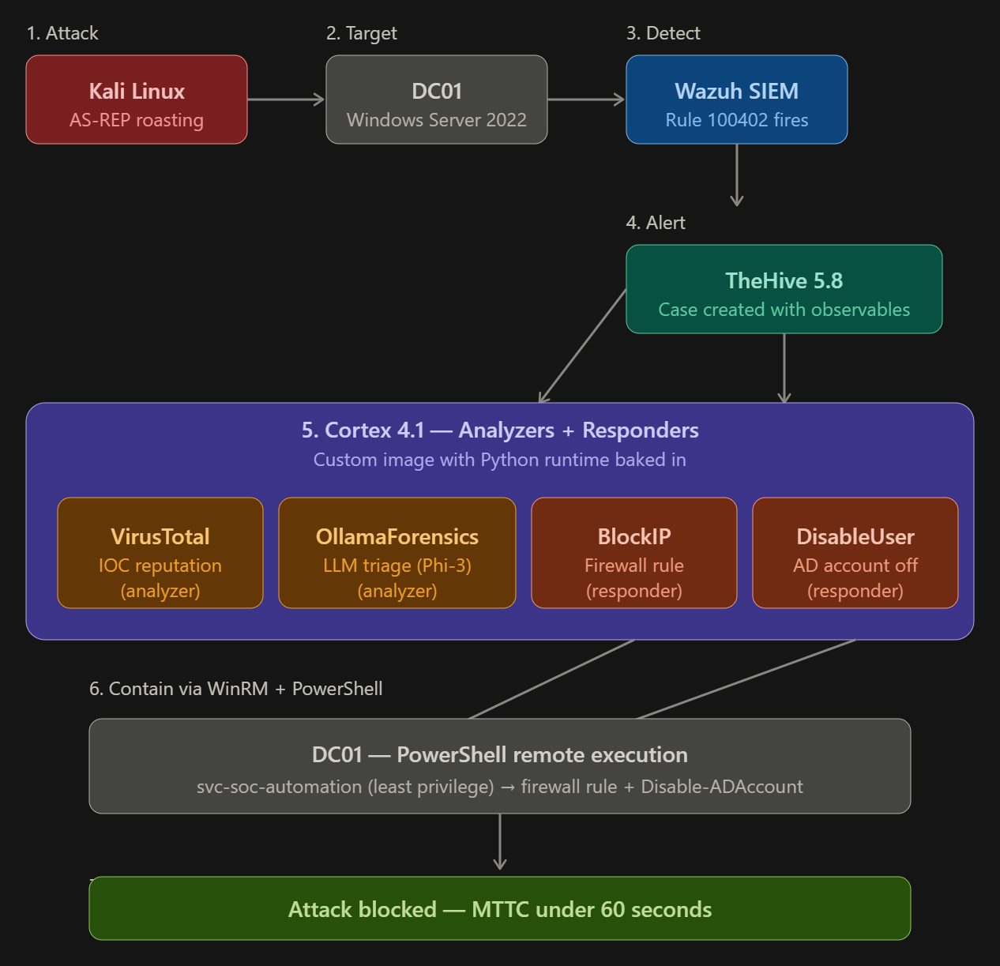
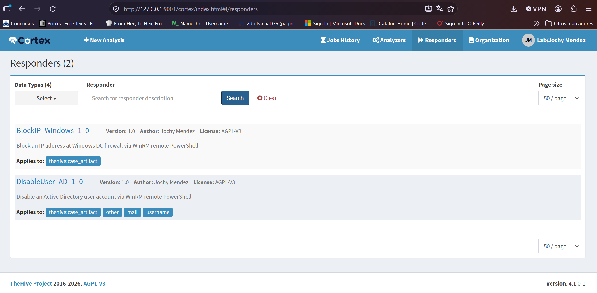
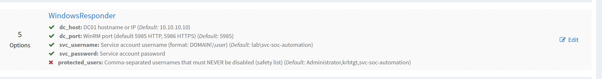
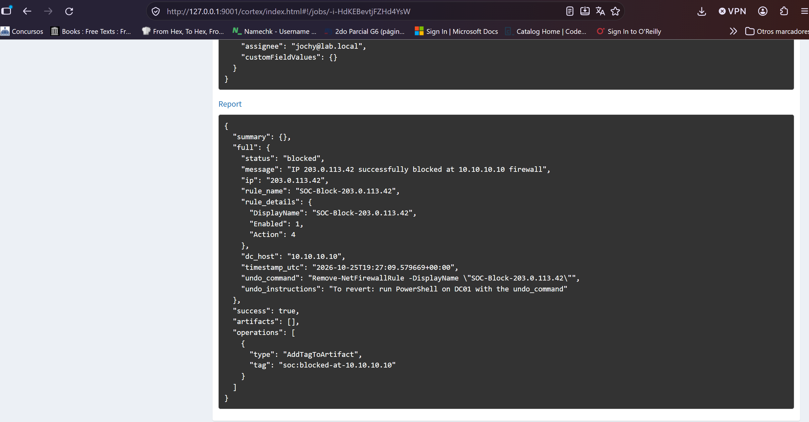
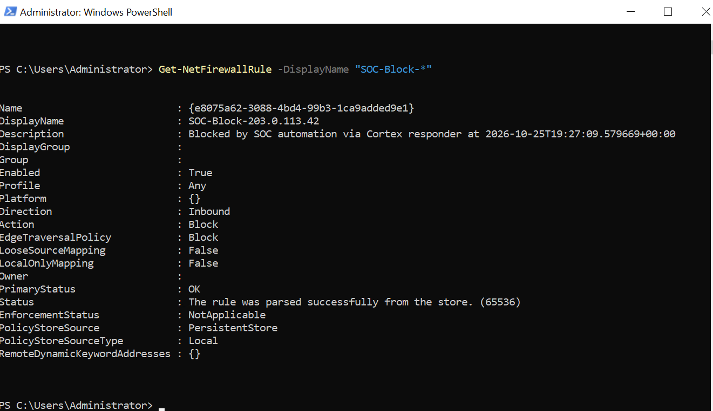
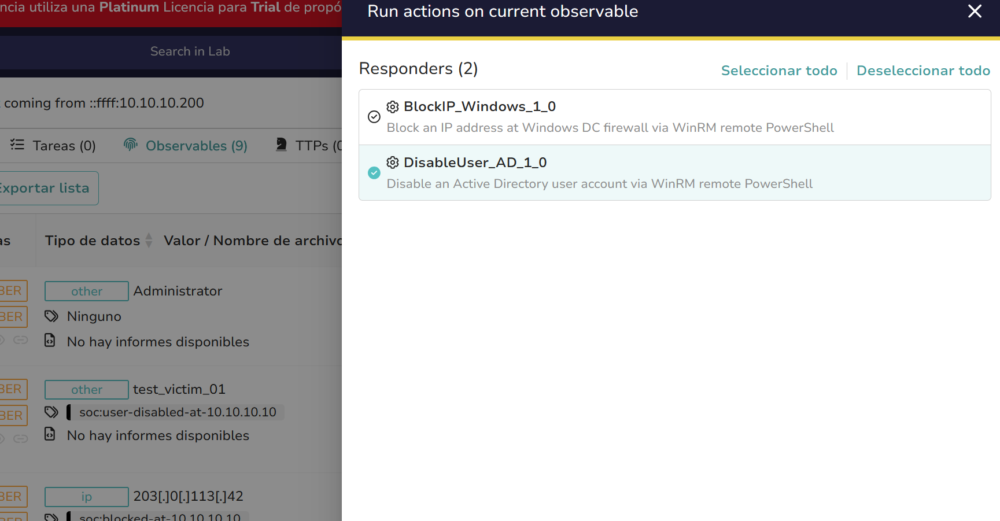
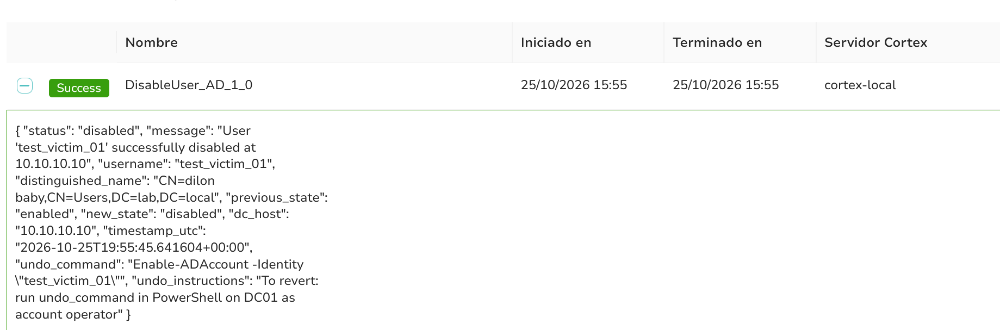
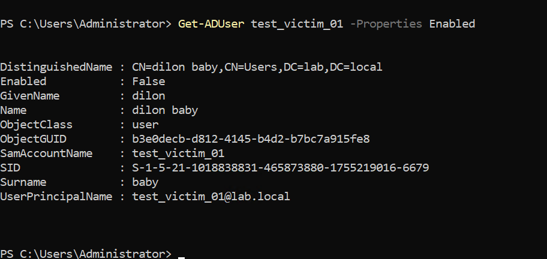
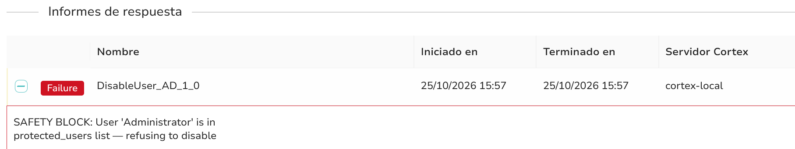

# Case 5 — SOAR Automated Containment: From Alert to Response

**Date:** October 2026 \
**Author:** Jochy Mendez\
**Lab:** Personal VirtualBox blue team lab\
**Tags:** `blue-team` `soar` `siem` `sirp` `containment` `active-response` `wazuh` `thehive` `cortex` `powershell` `winrm`

---

## TL;DR

Case 4 demostró **detección** end-to-end con LLM-assisted triage. Case 5 
completa el pipeline con **respuesta automatizada**: analista hace un click 
en TheHive, Cortex ejecuta un responder custom, PowerShell remoto se 
dispara contra DC01 vía WinRM, y la amenaza queda contenida en segundos.

Dos responders implementados:

1. **BlockIP_Windows** — bloquea IP atacante en firewall de Windows DC
2. **DisableUser_AD** — deshabilita cuenta AD comprometida (con safety list)

Del detect al contain: < 60 segundos.



---

## Why this matters

En el 95% de SOCs LATAM observados en consultoría, el flujo típico post-detección es:

- SIEM detecta attack pattern
- Analista valida alert
- Analista escribe ticket al equipo de infraestructura
- Equipo de infra bloquea IP en firewall (horas o días después)
- Equipo de IdM deshabilita usuario comprometido (horas o días después)

Durante ese window, el atacante tiene libre operación.

**SOAR responders eliminan ese window.** El analista con un click ejecuta 
la acción defensiva directamente, con audit log automático y undo instructions documentadas.

Case 5 demuestra cómo construir esto con stack open source, sin dependencia 
de productos comerciales (Palo Alto XSOAR, Splunk SOAR, etc.).

---

## Architecture extension (Case 4 → Case 5)

El pipeline de Case 4 (detect → alert → enrich) se extiende con una **response layer**:

- Analista en TheHive ve caso con observables enriquecidos (Case 4 flow)
- Click en observable → **Run Responder**
- Cortex dispatcha container responder
- Responder abre WinRM session a DC01 con credenciales dedicadas
- PowerShell ejecuta acción defensiva
- Report con `status`, `timestamp`, `undo_command` vuelve a TheHive
- Observable queda tagged `soc:blocked-at-10.10.10.10` o `soc:user-disabled-at-10.10.10.10`

---

## Lab components

| VM | Role | Case 5 change |
|----|------|---------------|
| DC01 (Windows Server 2022) | AD lab.local | WinRM habilitado + user svc-soc-automation en Account Operators |
| SOC-TOOLS (Ubuntu Server) | TheHive 5.8 + Cortex 4.1 + Ollama | Cortex ahora usa imagen custom con Python runtime baked in (fix de Case 4 tech debt) |
| Kali Linux | Attacker | Sin cambios — mismo flujo AS-REP del Case 4 |
| Wazuh | SIEM | Sin cambios |

---

## 0. Pre-requisite: Cortex persistence fix

Deuda técnica de Case 4: el workaround de instalar Python manualmente dentro del container de Cortex no era persistente. Un reinicio y Case 4 dejaba de funcionar.

**Fix:** imagen Docker custom que extiende Cortex 4.1.0 con python3 + cortexutils + requests preinstalados.

Ver [`artifacts/cortex-custom-Dockerfile`](./artifacts/cortex-custom-Dockerfile).

Después del rebuild del compose, el stack sobrevive `docker compose down && up` sin perder funcionalidad de analyzers custom.

---

## 1. BlockIP_Windows responder

Bloquea una IP en el firewall de Windows DC via WinRM remote PowerShell.

**Trigger:** analista en TheHive clickea observable IP → Run Responder → BlockIP_Windows

**Action:** `New-NetFirewallRule -DisplayName "SOC-Block-<IP>" -Direction Inbound -Action Block -RemoteAddress <IP>`

**Features:**
- Idempotent: si la rule ya existe, no la duplica, reporta `already_blocked`
- Audit: timestamp UTC + rule name + undo_command en el report
- Tag automático al observable: `soc:blocked-at-<dc_host>`

Ver código completo en:
- [`artifacts/BlockIP_Windows.py`](./artifacts/BlockIP_Windows.py)
- [`artifacts/BlockIP_Windows.json`](./artifacts/BlockIP_Windows.json)
- [`artifacts/BlockIP_Windows-Dockerfile`](./artifacts/BlockIP_Windows-Dockerfile)






---

## 2. DisableUser_AD responder

Deshabilita una cuenta AD vía `Disable-ADAccount` remoto.

**Trigger:** analista en TheHive clickea observable username → Run Responder → DisableUser_AD

**Action:** `Disable-ADAccount -Identity <username>`

**Safety features (critical design choices):**

### a) Protected users list
Lista hardcoded en config que previene deshabilitar cuentas críticas:
- `Administrator` (local y domain)
- `krbtgt` (ticket signing key — deshabilitarlo rompe TODO Kerberos del dominio)
- `svc-soc-automation` (el propio service account — self-DoS prevention)
- Lista extensible por organización

Si el responder recibe uno de estos usernames, ejecuta `self.error("SAFETY BLOCK: ...")` ANTES de tocar el DC. No hay forma de bypasearlo desde UI.

### b) Input sanitization
Rechaza usernames con caracteres sospechosos (previene PowerShell injection).

### c) Idempotency check
Si el user ya está disabled, no re-ejecuta, reporta `already_disabled`.

### d) Audit trail
Report incluye `distinguished_name`, `previous_state`, `new_state`, `timestamp_utc`, `undo_command`.

Ver código completo en:
- [`artifacts/DisableUser_AD.py`](./artifacts/DisableUser_AD.py)
- [`artifacts/DisableUser_AD.json`](./artifacts/DisableUser_AD.json)





### Safety block demo

Intento deshabilitar `Administrator`:



El responder rechaza la acción con mensaje explicativo. Esto es exactamente el comportamiento que previene incidentes operativos ("deshabilité Administrator por accidente mientras ejecutaba contención automática").

---

## 3. Security architecture decisions

### Decision 1: Service account dedicada (no Administrator)

**Problema:** usar Administrator del dominio para automation = toxic pattern. Si Cortex se compromete, atacante tiene domain admin.

**Solución:** usuario dedicado `svc-soc-automation` con permisos mínimos:
- Local Administrator **solo en DC01** (para firewall rules)
- Account Operators (para Disable-ADAccount)
- NO Domain Admin
- NO Enterprise Admin
- NO permisos sobre OUs de servidores críticos

### Decision 2: WinRM over HTTP (NOT HTTPS) — lab only

Para lab, WinRM HTTP (puerto 5985) con NTLM es suficiente. En producción se usaría WinRM HTTPS (puerto 5986) con certificado del DC + Kerberos auth.

Documentado como "future enhancement" para no bloquear implementation lab.

### Decision 3: UPN format (user@domain) over DOMAIN\user

En primer intento usé formato `lab\svc-soc-automation`. En JSON con escaping se vuelve pesadilla: `\\\\` para que resulte en `\\` para que pywinrm reciba `\`. **UPN format (`svc-soc-automation@lab.local`) elimina el problema completamente.**

Learning aplicable a cualquier integración pywinrm/Kerberos/NTLM.

### Decision 4: Credentials in Cortex configurationItems (lab) vs Vault (prod)

Lab: credenciales viven en Cortex DB (encrypted at rest).
Producción: integrar con HashiCorp Vault o Azure Key Vault via Cortex secret backends.

Documentado como next enhancement.

---

## 4. End-to-end attack simulation + response

**Scenario:** AS-REP Roasting attack from Kali (same as Case 4). Analista detecta en TheHive, decide contener en 2 clicks.

**Timeline:**

| Time | Event |
|------|-------|
| 00:00 | Kali ejecuta `impacket-GetNPUsers lab.local/ -no-pass -usersfile targets.txt` |
| 00:05 | Wazuh rule 100402 correlation triggers (5+ TGT requests from 10.10.10.200 in 60s) |
| 00:06 | Custom-thehive integration POST a TheHive — alerta creada |
| 00:10 | Analista (jochy@lab.local) importa alerta como caso |
| 00:20 | Analista corre analyzer OllamaForensics sobre observable IP 10.10.10.200 |
| 00:50 | LLM report: verdict "suspicious", confidence 85, recommended_actions includes "block source IP" |
| 00:55 | Analista hace click en observable → Run Responder → BlockIP_Windows |
| 01:10 | Cortex ejecuta responder → PowerShell en DC01 → firewall rule creada |
| 01:12 | Kali intenta nuevo request → connection blocked by firewall |

**Mean Time To Contain (MTTC): ~1 minuto.**

Compara con flow tradicional (ticket → infra team → next business day): ~24-48 horas.


---

## 5. Technical challenges solved

Ver [`notes/troubleshooting-log.md`](./notes/troubleshooting-log.md) para detalle completo.

Highlights:

1. **Cortex persistence (Case 4 tech debt)** → custom Dockerfile baking Python runtime
2. **WinRM credentials escaping hell** → pivot a UPN format (user@domain)
3. **Responder registered pero not callable from TheHive** → fix al `dataTypeList` en el .json
4. **Container lifecycle: `docker ps -a` vacío after test** → Cortex usa `--rm` flag, containers se eliminan post-ejecución (comportamiento esperado, no bug)

---

## 6. What's next (Case 6 and beyond)

- **Grafana + Prometheus dashboards** — métricas MTTR, MTTC, alert volume, responders executed per week
- **Additional responders** — reset user password, revoke Kerberos tickets, isolate endpoint via Windows Defender ATP
- **Playbook orchestration** — chain multiple responders (block IP + disable user + notify SOC manager via Slack) en un solo click
- **Compliance mapping** — mapear cada responder a NIST CSF 2.0 RS (Respond) controls y PCI-DSS v4
- **Human-in-the-loop confirmation** — para acciones destructivas, requerir aprobación de segundo analyst (dual control)

---

## References

- Wazuh integrator docs: https://documentation.wazuh.com/current/user-manual/manager/manual-integration.html
- TheHive 5 responders: https://docs.strangebee.com/thehive/user-guides/responders/
- Cortex responder dev: https://github.com/TheHive-Project/CortexDocs/blob/master/api/how-to-create-a-responder.md
- pywinrm library: https://pypi.org/project/pywinrm/
- MITRE D3FEND (Defensive Techniques): https://d3fend.mitre.org/
- NIST CSF 2.0 RS (Respond) function: https://csrc.nist.gov/pubs/cswp/29/the-nist-cybersecurity-framework-20/final

---

## Repo structure

```
blue-team-lab/
├── 01-kerberoasting-detection/
├── 02-bloodhound-genericall-escalation/
├── 03-asrep-roasting-detection/
├── 04-modern-soc-workflow-llm/
└── 05-soar-responders-automated-containment/   ← this case
```
